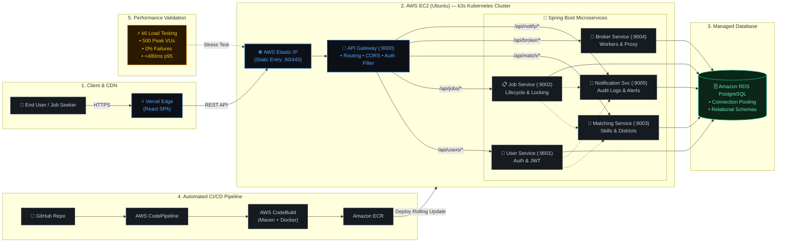

  <h1>Hi 👋, I'm Nisadu Nimsitha</h1>

  

  

    <strong>Computer Science Undergraduate @ University of Sri Jayewardenepura</strong> 
    <em>Building reliable cloud infrastructure, automated delivery pipelines, and resilient systems.</em>
  

  

    
    
    
  

---

### 👨‍💻 Engineering Profile

- ☁️ **Cloud & Infrastructure:** Hands-on designing cloud environments on **AWS**, managing infrastructure state with **Terraform (IaC)**, and container orchestration using **Docker** and lightweight **k3s/Kubernetes**.
- 🔄 **CI/CD & Automation:** Building secure, zero-trust deployment pipelines using **GitHub Actions (OIDC)**, **Jenkins**, and **Bash scripting** for end-to-end automation.
- 🐧 **Systems & Networking:** Strong foundation in **Linux systems administration**, networking fundamentals (DNS, HTTP/S, TCP/IP, reverse proxies), and web servers with **Nginx**.
- 📊 **Observability & SRE:** Implementing cluster & application telemetry with **Prometheus** metrics collection and **Grafana** visualization dashboards.

---

## 🛠️ Technical Stack

| Domain | Technologies & Tools |
| :--- | :--- |
| **Cloud & Platform** |      |
| **CI/CD & Observability** |     |
| **Systems & Networking** |     |
| **Backend & Databases** |       |
| **Frontend & ML** |     |

---

## 🚀 Featured Projects

| Project | Highlights & Engineering Scope | Tech Stack |
| :--- | :--- | :--- |
| 💼 **[Lanka MicroJob](https://github.com/nisa2003-ops/Lanka-Microjob-V1)** | Containerized microservices platform deployed on AWS EC2 with lightweight **k3s Kubernetes**, AWS CodePipeline CI/CD, managed AWS RDS PostgreSQL, and stress-tested with **k6**. | `AWS` `k3s` `Docker` `Spring Boot` `React` |
| ☁️ **CloudOps Infrastructure Platform** | End-to-end automated cloud delivery platform leveraging **Terraform IaC**, zero-trust **GitHub Actions OIDC** pipelines, and a full observability stack (**Prometheus + Grafana**). | `Terraform` `AWS` `Docker` `Prometheus` `Grafana` |
| 🦟 **[Dengue Risk MLOps](https://github.com/nisa2003-ops/Dengue-Risk-MLOps-1)** | Automated machine learning pipeline predicting regional outbreak risks, featuring model experiment tracking with **MLflow** and containerized API serving via **FastAPI**. | `Python` `Scikit-learn` `MLflow` `FastAPI` `Docker` |
| 🎭 **[Sathsara Dahana 2026](https://www.sathsaradahana.live/)** | Production web platform for USJ's flagship cultural concert serving high traffic with a custom interactive retro boot terminal, live audition results, and low-latency client rendering. | `Next.js` `React` `Tailwind CSS` `Vercel` |

 

  
<strong>📐 View Lanka MicroJob System & CI/CD Architecture</strong>

   

#### 📌 Key Architecture Highlights
* **Edge & Ingress:** Frontend delivered via Vercel Edge CDN connecting to an AWS Elastic IP and Spring Cloud API Gateway managing CORS, routing, and auth verification.
* **Microservices Mesh on k3s:** 5 isolated Spring Boot microservices running inside a lightweight `k3s` Kubernetes cluster on an Ubuntu EC2 instance.
* **Automated CI/CD:** GitHub webhook triggers AWS CodePipeline & AWS CodeBuild for container packaging and push to Amazon ECR, followed by rolling updates.
* **Sustained Performance:** Validated under high load via **k6** simulating **500 virtual users with zero error rates** and sub-second p95 latency.

---

<h2 align="center">📊 Activity & Contributions</h2>

  <table border="0">
    <tr>
      <td align="center" width="50%">
        
      </td>
      <td align="center" width="50%">
        
      </td>
    </tr>
  </table>
   
  

 

  Designed & maintained with care by <a href="https://github.com/nisa2003-ops">Nisadu Nimsitha</a>

