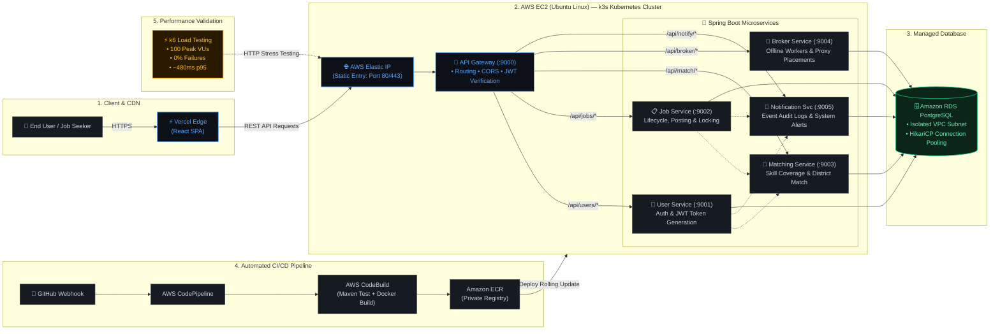

  <h1>Hi 👋, I'm Nisadu Nimsitha</h1>

  

  

    <strong>Computer Science Undergraduate | Cloud Infrastructure, DevOps & Networking</strong> 
    <em>University of Sri Jayewardenepura, Sri Lanka</em>
  

  

    <em>"Building reliable cloud infrastructure, automated delivery pipelines, and resilient systems."</em>
  

  

    
    
    
    
  

---

### 👨‍💻 Engineering Profile

- ☁️ **Cloud & Infrastructure:** Hands-on designing cloud environments on **AWS**, managing infrastructure state with **Terraform (IaC)**, and container orchestration using **Docker** and lightweight **k3s/Kubernetes**. Automated provisioning of VPC networking, subnets, route tables, security groups, and container registries (Amazon ECR).
- 🔄 **CI/CD & Automation:** Building secure, automated delivery pipelines using **GitHub Actions** and **Jenkins**, paired with robust **Bash scripting** and **Git**. Implementing zero-trust deployment architectures leveraging AWS IAM OIDC federation and container vulnerability gating with Trivy.
- 🐧 **Systems & Networking:** Solid foundation in **Linux systems administration** (Ubuntu, systemd, process lifecycle, SSH), core networking protocols (**TCP/IP**, **DNS**, **HTTP/HTTPS**, routing fundamentals, CIDR/VLSM subnetting), and reverse proxying with **Nginx**.
- 📊 **Observability & Reliability:** Implementing full-stack telemetry and SRE practices using **Prometheus** for metrics collection (RED metrics, latency histograms) and **Grafana** for operational dashboards. Conducting automated load and performance testing with **k6** to benchmark throughput and latency.

---

## 🛠️ Technical Stack

| Category | Technologies & Tools |
| :--- | :--- |
| **Cloud Platforms** |   |
| **Infrastructure as Code** |  |
| **Containers & Orchestration** |    |
| **CI/CD & GitOps** |   |
| **Systems & Networking** |      |
| **Monitoring & Observability** |   |
| **Programming Languages** |    |
| **Backend & Databases** |     |
| **Machine Learning & MLOps** |   |

---

## 🚀 Featured Projects

| Project | Highlights & Engineering Scope | Tech Stack | Links |
| :--- | :--- | :--- | :--- |
| ☁️ **CloudOps Infrastructure Platform** | Enterprise-aligned automated cloud delivery and SRE platform. Implements modular **Terraform IaC** for AWS VPC infrastructure, multi-stage Docker containerization of a FastAPI service, zero-trust **GitHub Actions OIDC** CI/CD with Trivy vulnerability scanning, and an operational **Prometheus & Grafana** observability stack. | `Terraform` `AWS` `Docker` `GitHub Actions` `Prometheus` `Grafana` `FastAPI` | [Repository](https://github.com/nisa2003-ops/Cloudops-platform) |
| 💼 **Lanka MicroJob** | Distributed job platform featuring six containerized Spring Boot microservices deployed on **AWS EC2** using a single-node lightweight **k3s Kubernetes** cluster. Features automated **AWS CodePipeline/CodeBuild/ECR** CI/CD, isolated **Amazon RDS PostgreSQL** with connection pooling, and multi-stage **k6 performance benchmarking** (sustaining 100 peak VUs with 0% failures and ~480ms p95 latency). | `Spring Boot` `AWS EC2` `k3s` `Docker` `CodePipeline` `Amazon RDS` `k6` | [Repository](https://github.com/nisa2003-ops/Lanka-Microjob-V1) · [Live Demo](https://lanka-microjob.vercel.app/) · [Case Study](https://medium.com/@nisadu2003/from-docker-compose-to-kubernetes-on-aws-deploying-lanka-microjob-with-ci-cd-rds-and-load-6bfe6eea0be4) |
| 🦟 **Dengue Risk MLOps** | End-to-end machine learning pipeline predicting regional dengue outbreak risks from epidemiological and meteorological records. Features chronological train/validation splitting (13,150 training samples) to eliminate data leakage, **MLflow** experiment tracking across models, and asynchronous inference serving via **FastAPI** with automated **GitHub Actions** CI testing. | `Python` `Scikit-learn` `MLflow` `FastAPI` `Docker` `GitHub Actions` | [Repository](https://github.com/nisa2003-ops/Dengue-Risk-MLOps-1) |
| 🎭 **Sathsara Dahana 2026** | Production web platform developed collaboratively for USJ's flagship cultural concert. Built with **Next.js**, **React**, and **Tailwind CSS**; features an audition verification portal for real-time candidate status lookups by index number, an interactive HTML5 canvas terminal bootloader, and low-latency client rendering hosted on **Vercel**. | `Next.js` `React` `Tailwind CSS` `Canvas API` `Vercel` | [Live Site](https://www.sathsaradahana.live/) |

 

  
<strong>📐 View Lanka MicroJob System & CI/CD Architecture Blueprint</strong>

   

#### 📌 Verified System Architecture Details
* **Edge & Ingress:** React Single Page Application served via Vercel Edge CDN connecting to an AWS Elastic IP attached to an Ubuntu EC2 host. Traffic terminates at a Spring Cloud API Gateway managing CORS, routing, and token validation.
* **Microservices Mesh on k3s:** Six Spring Boot services running inside a lightweight `k3s` Kubernetes cluster using declarative YAML manifests, internal ClusterIP services, and health probes for liveness/readiness.
* **Automated CI/CD Delivery:** GitHub push events trigger AWS CodePipeline and CodeBuild to execute Maven test suites, assemble Docker containers, push to Amazon ECR, and perform automated rolling updates on the k3s cluster.
* **Verified Performance Testing:** Evaluated with **k6** simulating multi-stage traffic up to **100 concurrent virtual users (VUs)** with **0% request failure** and a **p95 response time of ~480ms** against Amazon RDS PostgreSQL with connection pooling.

---

## ⚙️ Engineering Highlights

- **Infrastructure as Code (IaC):** Architected modular Terraform configurations to provision repeatable AWS topologies—custom VPCs, public/private subnets, internet gateways, route tables, and security groups following least-privilege principles.
- **Container Orchestration & Clustering:** Packaged multi-service Spring Boot backends and Python microservices into production Docker images, orchestrating containerized workloads on AWS EC2 using lightweight `k3s` Kubernetes.
- **Zero-Trust CI/CD Automation:** Engineered GitHub Actions workflows utilizing AWS IAM OIDC federation to eliminate static access keys, integrating Trivy container vulnerability scanning into the deployment gate.
- **Cloud Delivery Pipelines:** Built automated AWS CodePipeline and CodeBuild workflows triggered by GitHub webhooks to compile Java artifacts, build containers, and push to Amazon ECR.
- **SRE & Metric Instrumentation:** Configured Prometheus scrape targets for RED metrics (Rate, Errors, Duration) and latency histograms, visualizing service telemetry with provisioned Grafana dashboards.
- **System Load Benchmarking:** Designed and executed multi-stage k6 performance test suites simulating concurrent user ramp-up to validate latency thresholds and verify error-free database connection pooling under load.

---

## 🔭 Currently Exploring

- **Advanced Kubernetes & GitOps:** Ingress controllers, Helm charts, custom resource definitions (CRDs), and declarative delivery patterns (Argo CD concepts).
- **Cloud Infrastructure:** Multi-cloud architectures (AWS & Azure), IAM least-privilege enforcement, automated secret rotation, and VPC security boundary hardening.
- **Linux Systems Administration:** Deep dive into Linux kernel subsystems, systemd unit management, cgroups, process isolation, and network namespaces.
- **Network Automation & Telemetry:** Enterprise network topologies, routing automation, OpenTelemetry metrics collection, and eBPF-based observability.

---

## 🎓 Certifications & Learning

| Organization | Verified Credentials & Learning |
| :--- | :--- |
| **AWS Academy** | [Cloud Foundations](https://www.credly.com/badges/acd4df5d-898e-49c9-8609-7b883f855d70/linked_in_profile) · [Cloud Security Foundations](https://www.credly.com/badges/0837b3eb-49ed-4e86-a210-a1973df227e6/public_url) · [Microservices & CI/CD Builder](https://www.credly.com/badges/3508f16c-bc97-4ca3-98d1-a0808731e073/public_url) · [Cloud Security Builder](https://www.credly.com/badges/69c7a723-5514-4544-b8e3-d28712da6f91/public_url) |
| **Cisco Academy** | [Networking Basics](https://www.credly.com/badges/cf521714-f640-46cc-b75e-948206550a1d/public_url) · [Introduction to Packet Tracer](https://www.credly.com/badges/2d0be4e4-a562-4b2a-a779-1f2313a7a4e9/public_url) · *`Linux Essentials (In Progress)`* |
| **KodeKloud** | [Kubernetes Crash Course](https://learn.kodekloud.com/certificate/8a90819f-6656-4cc5-ba1a-1e0103bd7e66) · [Linux for Absolute Beginners](https://learn.kodekloud.com/certificate/16b70d88-49fa-45b6-87ff-315738e5ee4b) · *`GitOps Platform Eng (In Progress)`* |

---

## 🧠 Engineering Philosophy

- **Automate Repetitive Infrastructure Tasks:** Eliminate manual server administration with declarative Infrastructure as Code and automated pipelines.
- **Build Reproducible and Maintainable Systems:** Ensure environments can be destroyed and recreated reliably from version-controlled configurations.
- **Design for Reliability and Scalability:** Implement defensive architecture, health probes, and connection pooling to withstand workload spikes.
- **Monitor and Detect Failures Early:** Instrument systems with proactive telemetry and alerts before issues impact end users.
- **Continuous Improvement Through Testing:** Validate changes through automated linting, unit tests, vulnerability scans, and load testing.

---

<h2 align="center">📊 Activity & Contributions</h2>

  <table border="0">
    <tr>
      <td align="center" width="50%">
        
      </td>
      <td align="center" width="50%">
        
      </td>
    </tr>
  </table>
   
  
    
  

 

---

  

    <strong>Nisadu Nimsitha</strong> · <em>Computer Science Undergraduate</em> 
    <a href="https://www.linkedin.com/in/nisadu-nimsitha-512a24348">LinkedIn</a> • 
    <a href="mailto:nisadu2003@gmail.com">Email</a> • 
    <a href="https://github.com/nisa2003-ops">GitHub</a> • 
    <a href="https://nisadu-nimsitha.vercel.app">Portfolio</a>
  

  Designed & maintained with care

