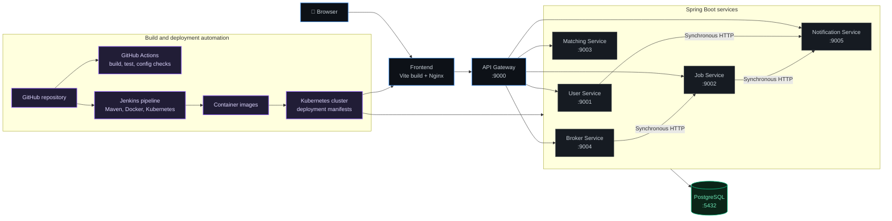

  <h1>Hi 👋, I'm Nisadu Nimsitha</h1>

  

  

    <strong>Computer Science Undergraduate @ University of Sri Jayewardenepura</strong> 
    <em>Building reliable cloud infrastructure, automated deployment pipelines, and resilient networked systems.</em>
  

  

    
    
    
  

---

## 👨‍💻 Engineering Profile

- ☁️ **Cloud & Infrastructure:** AWS-focused cloud architecture, Terraform-based infrastructure design, Docker containerization, and Kubernetes/k3s deployment patterns.
- 🔄 **CI/CD & Automation:** GitHub Actions build gates, Jenkins pipelines, Git workflows, Bash automation, and repeatable deployment processes.
- 🐧 **Systems & Networking:** Linux foundations, TCP/IP, DNS, HTTP/HTTPS, routing concepts, reverse proxies, and Nginx-based application delivery.
- 📊 **Observability & Reliability:** Prometheus metrics, Grafana dashboards, health checks, alert rules, and performance-focused reliability practices.

The profile distinguishes completed implementation from documented designs and active learning.

---

## 🛠️ Technical Stack

| Category | Technologies |
| :--- | :--- |
| **Cloud Platforms** |    |
| **Infrastructure as Code** |  |
| **Containers & Orchestration** |    |
| **CI/CD & GitOps** |     |
| **Systems & Networking** |     |
| **Monitoring & Observability** |   |
| **Programming Languages** |    |
| **Backend & Databases** |     |
| **Machine Learning & MLOps** |   |

---

## 🚀 Featured Projects

### 1. [CloudOps Infrastructure Platform](https://github.com/nisa2003-ops/Cloudops-platform)

A FastAPI-based cloud reliability portfolio platform with Docker Compose, Prometheus scrape configuration, Grafana integration, health endpoints, alert rules, and documented AWS/Terraform deployment structure.

**Technologies:** `AWS` `Terraform` `Docker` `FastAPI` `Prometheus` `Grafana`

> The repository documents OIDC and Terraform deployment patterns; the current default branch does not contain a committed GitHub Actions workflow or populated Terraform resources, so those are not presented as completed implementation.

### 2. [NetworkOps Automation Platform](https://github.com/nisa2003-ops/NetworkOps)

An undergraduate networking and DevOps lab scaffold covering GNS3 IPv4 topology design, a tested FastAPI service, Docker packaging, planned Kubernetes/k3d deployment, Jenkins automation, Terraform tasks, and Prometheus/Grafana monitoring.

**Technologies:** `GNS3` `Linux` `FastAPI` `Docker` `Kubernetes` `Jenkins` `Terraform` `Prometheus`

> Current repository status: **Phase 1 — design documentation and repository scaffold.** Deployment, monitoring, and network automation phases are not claimed as completed.

### 3. [Lanka MicroJob](https://github.com/nisa2003-ops/Lanka-Microjob-V1)

A university microservices platform for workers, employers, brokers, and administrators, with Spring Boot services, a Spring Cloud Gateway, PostgreSQL persistence, Docker packaging, Kubernetes manifests, and Jenkins/GitHub Actions automation.

**Technologies:** `Java` `Spring Boot` `Docker` `Kubernetes` `Jenkins` `GitHub Actions` `PostgreSQL` `Nginx`

**Live application:** [lanka-microjob.vercel.app](https://lanka-microjob.vercel.app/)

  
<strong>📐 View Lanka MicroJob architecture and delivery flow</strong>

   

The repository verifies six Java services, a browser frontend, shared PostgreSQL persistence, Docker Compose, Kubernetes manifests, a GitHub Actions build gate, and a Jenkins build/push/deploy pipeline. No committed k6 script or result report was found, so load-test numbers are intentionally omitted.

### 4. [Dengue Risk MLOps](https://github.com/nisa2003-ops/Dengue-Risk-MLOps-1)

A reproducible Python and Scikit-learn pipeline for next-week dengue risk classification using validated historical case and weather data, chronological evaluation, model bundles, and local prediction workflows.

**Technologies:** `Python` `Scikit-learn` `XGBoost` `Pandas` `PyYAML` `pytest`

> Historical MLflow/MLruns artifacts are retained in the repository, while the current documented workflow trains and evaluates locally without a tracking server or FastAPI/Docker runtime.

### 5. [Sathsara Dahana 2026](https://github.com/nisa2003-ops/sathsara-dahana-demo)

An interactive university event website built with Next.js, React, TypeScript, Tailwind CSS, Firebase-backed content features, and a production deployment configuration.

**Technologies:** `Next.js` `React` `TypeScript` `Tailwind CSS` `Firebase`

**Live application:** [sathsaradahana.live](https://www.sathsaradahana.live/)

---

## ⚙️ Engineering Highlights

- Designed and documented AWS/Terraform cloud deployment patterns in the CloudOps platform.
- Built containerized FastAPI services with health endpoints and Prometheus instrumentation.
- Implemented GitHub Actions build/test gates and Jenkins-based build, image-push, and Kubernetes deployment workflows.
- Defined Kubernetes workloads and rollout checks for a multi-service Spring Boot platform.
- Configured Prometheus scrape targets, alert rules, and Grafana integration for infrastructure-oriented observability.
- Built chronological data validation, training, evaluation, and saved-model workflows for an academic ML system.

---

## 🔭 Currently Exploring

- Advanced Kubernetes networking and workload operations.
- GitOps-oriented deployment automation.
- Cloud infrastructure security and identity boundaries.
- Network automation with reproducible lab environments.
- Linux systems administration and service hardening.
- Infrastructure monitoring, alerting, and failure analysis.

---

## 🎓 Certifications & Learning

- **Cisco Networking Basics** — course record mentioned in the profile brief; completion status and a public certificate URL are not currently verifiable from the public repositories.
- **Cisco Linux Essentials** — course record mentioned in the profile brief; completion status and a public certificate URL are not currently verifiable from the public repositories.

---

## 🧠 Engineering Philosophy

- Automate repetitive infrastructure tasks.
- Build reproducible and maintainable systems.
- Design for reliability and scalability.
- Monitor systems and identify failures early.
- Continuously improve through testing and experimentation.

---

<h2 align="center">📊 Activity & Contributions</h2>

  <table border="0">
    <tr>
      <td align="center" width="50%">
        
      </td>
      <td align="center" width="50%">
        
      </td>
    </tr>
  </table>
   
  
    
  

 

  Designed and maintained with care by <a href="https://github.com/nisa2003-ops">Nisadu Nimsitha</a>

