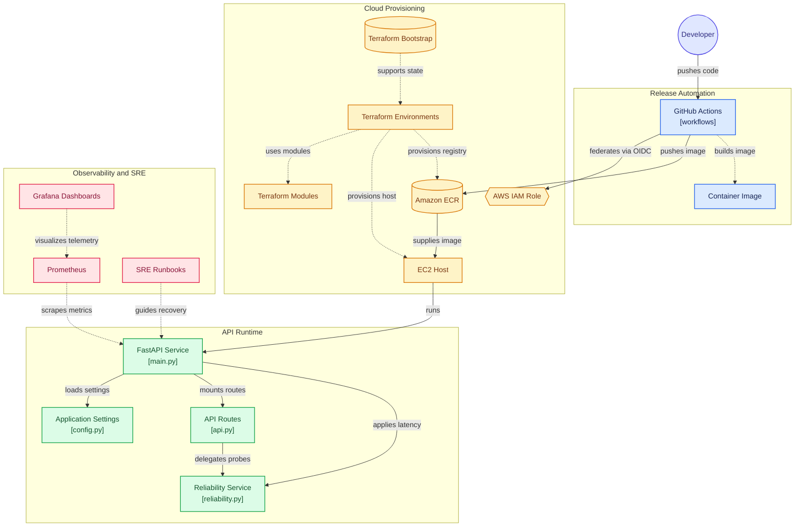
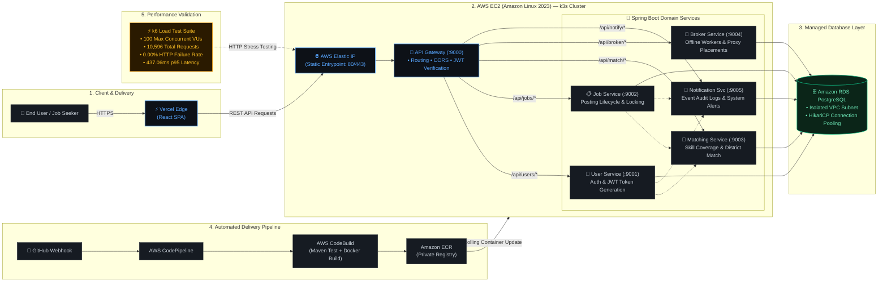

  <h1>Hi 👋, I'm Nisadu Nimsitha</h1>

  

  

    <strong>Computer Science Undergraduate | Cloud, DevOps & MLOps</strong> 
    <em>University of Sri Jayewardenepura, Sri Lanka</em>
  

  

    <em>"Building reliable cloud infrastructure, automated delivery pipelines, and resilient systems."</em>
  

  

    🟢 <strong>Open to DevOps / Cloud / MLOps internships</strong>
  

  

    
    
    
    
  

---

### 👨‍💻 Engineering Profile

- ☁️ **Cloud & IaC:** AWS (VPC, EC2, ECR, RDS, IAM) provisioned with modular Terraform; workloads on Docker and single-node k3s.
- 🔄 **CI/CD & Security:** GitHub Actions, Jenkins and AWS CodePipeline, with OIDC-based AWS auth (no static keys) and Trivy image scanning.
- 🐧 **Linux & Networking:** Amazon Linux and Ubuntu administration, systemd, Nginx, TCP/IP, DNS, CIDR/VLSM subnetting.
- 📊 **Observability & MLOps:** Prometheus and Grafana (RED metrics), k6 load testing, MLflow experiment tracking.

---

## 🛠️ Technical Stack

| Category | Technologies & Tools |
| :--- | :--- |
| **Cloud & IaC** |   |
| **Containers & Orchestration** |    |
| **CI/CD & Automation** |     |
| **Systems & Networking** |    |
| **Monitoring** |   |
| **Languages** |    |
| **Backend & Databases** |     |
| **ML & MLOps** |   |

---

## 🚀 Featured Projects

| Project | Highlights | Tech Stack | Links |
| :--- | :--- | :--- | :--- |
| ☁️ **CloudOps Infrastructure Platform** | Terraform-provisioned AWS VPC, containerized FastAPI service, OIDC-based GitHub Actions CI/CD with no static AWS secrets, Trivy scanning, and Prometheus/Grafana telemetry. | `Terraform` `AWS` `Docker` `GitHub Actions` `Prometheus` `Grafana` `FastAPI` | [Repository](https://github.com/nisa2003-ops/Cloudops-platform) |
| 💼 **Lanka MicroJob** | Five Spring Boot microservices behind a Spring Cloud API Gateway on a single-node k3s cluster (AWS EC2), with CodePipeline/CodeBuild/ECR delivery, RDS PostgreSQL, and k6 load testing (0% failures, 437 ms p95). | `Spring Boot` `AWS EC2` `k3s` `Docker` `CodePipeline` `Amazon RDS` `k6` | [Repository](https://github.com/nisa2003-ops/Lanka-Microjob-V1) · [Live Demo](https://lanka-microjob.vercel.app/) · [Case Study](https://medium.com/@nisadu2003/from-docker-compose-to-kubernetes-on-aws-deploying-lanka-microjob-with-ci-cd-rds-and-load-6bfe6eea0be4) |
| 🦟 **Dengue Risk MLOps** | End-to-end pipeline predicting regional dengue risk (LOW / MEDIUM / HIGH), with chronological splits to avoid temporal leakage, MLflow experiment tracking, FastAPI inference, and GitHub Actions CI. | `Python` `Scikit-learn` `MLflow` `FastAPI` `Docker` `GitHub Actions` | [Repository](https://github.com/nisa2003-ops/Dengue-Risk-MLOps-1) |
| 🎭 **Sathsara Dahana 2026** | Web platform for USJ's cultural concert, built as a team. My contributions: an audition status lookup portal and an interactive canvas terminal bootloader. | `Next.js` `React` `Tailwind CSS` `Canvas API` `Vercel` | [Live Site](https://www.sathsaradahana.live/) |

 

  
<strong>📐 View CloudOps Platform Architecture & Delivery Workflow</strong>

   

#### 📌 Engineering Implementation Details
* **Infrastructure as Code:** Modular Terraform configuration organizing VPC, subnets, route tables, security groups, IAM roles, and Amazon ECR repositories, backed by S3 remote state and DynamoDB locks.
* **Zero-Static-Credential CI/CD:** Uses GitHub Actions OIDC federation (`AssumeRoleWithWebIdentity`) to authenticate with AWS STS without saving long-lived AWS secret access keys in repository secrets.
* **Security & Hardening:** EC2 administration managed via AWS Systems Manager (SSM) Session Manager with SSH port 22 explicitly closed. Container images scanned for vulnerabilities via Trivy during CI.
* **Telemetry & Health Probes:** FastAPI service instrumented with Prometheus RED metrics (request count, HTTP error codes, duration histograms) with distinct `/health` and `/ready` endpoints.

 

  
<strong>📐 View Lanka MicroJob System & CI/CD Architecture</strong>

   

#### 📌 Verified System Details & Performance Benchmark
* **Service Separation:** Five decoupled Spring Boot domain microservices (`user`, `job`, `matching`, `broker`, `notification`) running alongside an independent Spring Cloud API Gateway handling routing, CORS preflights, and token validation.
* **Orchestration & Deployment:** Deployed on an **Amazon Linux 2023** AWS EC2 host running lightweight **k3s Kubernetes** using declarative YAML manifests and ClusterIP internal routing.
* **Delivery Workflow:** GitHub push triggers AWS CodePipeline and CodeBuild to compile Java artifacts, assemble Docker images, push to Amazon ECR, and execute rolling container updates.
* **Verified k6 Load Test Summary:**
  | Metric | Measured Value | Target / Threshold |
  | :--- | :--- | :--- |
  | **Virtual Users (VUs)** | Up to 100 Concurrent VUs (5-stage ramp) | 100 Max VUs |
  | **Test Duration** | 4 minutes 0 seconds | 4m 0s |
  | **Total HTTP Requests** | 10,596 requests (43.93 reqs/sec) | Continuous |
  | **HTTP Failure Rate** | **0.00%** (0 failed requests) | `< 5.0%` |
  | **Average Latency** | 359.17 ms | — |
  | **p90 Latency** | 398.43 ms | — |
  | **p95 Latency** | **437.06 ms** (Public Stats: 423ms, Jobs: 443ms, Notifications: 434ms) | `< 2,000 ms` |
* *Note on Deployment Scope:* Benchmarks were measured against a single-node k3s cluster on EC2 with Amazon RDS PostgreSQL to validate service throughput and HikariCP connection pooling stability under simulated load. A single-node environment provides functional validation but does not represent high availability (HA) or multi-region production scaling.

---

## 🔭 Currently Exploring

- **Kubernetes & GitOps:** Helm, ingress controllers, and declarative delivery with Argo CD concepts.
- **Linux Internals:** systemd unit management, cgroups, and network namespaces.
- **Cloud Security:** IAM least-privilege design and VPC boundary hardening, with Azure as a second platform.

---

## 🎓 Certifications & Learning

| Organization | Verified Credentials & Learning |
| :--- | :--- |
| **AWS Academy** | [Cloud Foundations](https://www.credly.com/badges/acd4df5d-898e-49c9-8609-7b883f855d70/linked_in_profile) · [Cloud Security Foundations](https://www.credly.com/badges/0837b3eb-49ed-4e86-a210-a1973df227e6/public_url) · [Microservices & CI/CD Builder](https://www.credly.com/badges/3508f16c-bc97-4ca3-98d1-a0808731e073/public_url) · [Cloud Security Builder](https://www.credly.com/badges/69c7a723-5514-4544-b8e3-d28712da6f91/public_url) |
| **Cisco Academy** | [Networking Basics](https://www.credly.com/badges/cf521714-f640-46cc-b75e-948206550a1d/public_url) · [Introduction to Packet Tracer](https://www.credly.com/badges/2d0be4e4-a562-4b2a-a779-1f2313a7a4e9/public_url) · *`Linux Essentials (In Progress)`* |
| **KodeKloud** | [Kubernetes Crash Course](https://learn.kodekloud.com/certificate/8a90819f-6656-4cc5-ba1a-1e0103bd7e66) · [Linux for Absolute Beginners](https://learn.kodekloud.com/certificate/16b70d88-49fa-45b6-87ff-315738e5ee4b) · [GitOps Platform Engineering](https://www.virtualbadge.io/certificate-validator?credential=bbaee91b-1973-482c-8714-0d51c5293e85) |

---

<h2 align="center">📊 Activity & Contributions</h2>

  <table border="0">
    <tr>
      <td align="center" width="50%">
        
      </td>
      <td align="center" width="50%">
        
      </td>
    </tr>
  </table>
   
  
    
  

 

---

  

    <strong>Nisadu Nimsitha</strong> · <em>Computer Science Undergraduate</em> 
    <strong>Open to DevOps / Cloud / MLOps internships</strong> — <a href="mailto:nisadu2003@gmail.com">get in touch</a> 
    <a href="https://www.linkedin.com/in/nisadu-nimsitha">LinkedIn</a> • 
    <a href="mailto:nisadu2003@gmail.com">Email</a> • 
    <a href="https://github.com/nisa2003-ops">GitHub</a> • 
    <a href="https://nisadu-nimsitha.vercel.app">Portfolio</a>
  

